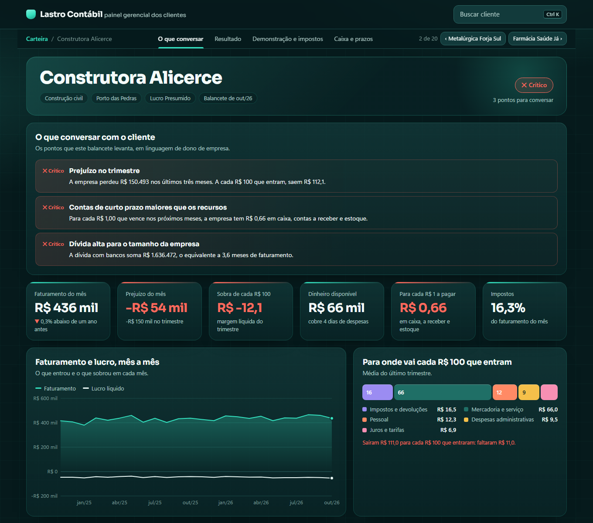
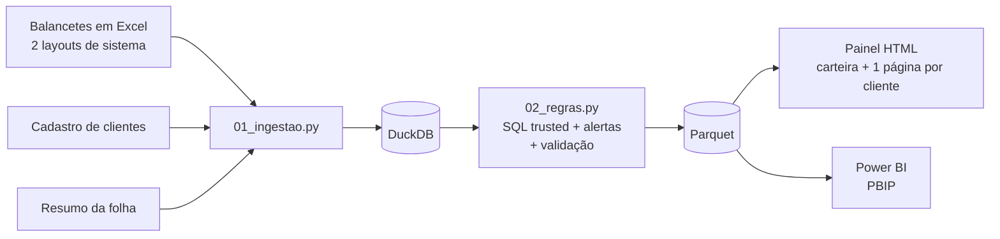

# Painel gerencial para clientes de escritório contábil — Lastro Contábil

O contador entrega balancete; o dono da empresa não lê balancete. Este projeto transforma o balancete mensal de cada cliente num painel que o empresário entende, com alertas já escritos em linguagem de negócio, e dá ao contador uma visão da carteira inteira: quem precisa de conversa agora e sobre o quê.

> **Dados 100% fictícios.** O escritório Lastro Contábil, as 20 empresas clientes, os CNPJs (com dígitos inválidos de propósito), as cidades e os números são gerados por `gerador/gerar_dados.py` com semente fixa.
>
> **Regras de imposto simplificadas.** As tabelas do Simples Nacional e os percentuais dos outros regimes servem à demonstração. Não usar como base fiscal sem conferência de um contador.




## O que o painel entrega

**Para o contador (carteira):** todos os clientes numa tela, ordenados por quem mais precisa de atenção, com a pauta da semana pronta.

**Para o empresário (uma página por cliente):**

- **O que conversar:** os alertas do balancete em frases com o número dentro. Ex.: "De cada R$ 100 vendidos sobravam R$ 55,3 depois do custo; agora sobram R$ 49,2."
- **Resultado:** faturamento e lucro mês a mês, e a DRE resumida contra o mês anterior e um ano antes.
- **Para onde vai cada R$ 100 que entram:** impostos, mercadoria, pessoal, despesas, juros e o que sobra.
- **Caixa e dívida**, prazo de recebimento e dias de estoque.
- **Simples Nacional:** faixa atual, alíquota efetiva e quanto falta para subir de faixa ou sair do regime.

O endereço guarda o cliente aberto (`index.html#cliente=C008`), então o contador manda ao empresário o link direto do painel dele.

## A carteira fictícia

Vinte empresas, cada uma com um cenário para o painel ter o que mostrar: saudável, perto de mudar de faixa no Simples, perto do limite de R$ 4,8 milhões, sazonal, margem caindo, estoque inchado, inadimplência subindo, endividada, em prejuízo, empresa nova, balancete atrasado. A lista completa está em [docs/cenarios.md](docs/cenarios.md).

Os balancetes saem de um **simulador contábil de partidas dobradas**: cada venda, compra, folha, imposto e empréstimo é um lançamento com débito e crédito, então o balancete fecha em todos os meses.

## Arquitetura



- **Ingestão:** os balancetes chegam em dois layouts, como de dois sistemas contábeis (conta `1.1.01` com saldo com sinal, ou conta `1101` com coluna D/C). O importador reconhece pelo cabeçalho e entrega um formato só.
- **Regras:** uma por arquivo SQL, comentada, em `pipeline/sql/`.
- **Validação:** o pipeline só termina se a contabilidade fecha.

## Os dois painéis

**HTML** (`painel_html/saida/index.html`): um arquivo estático, com a carteira e a página de cada cliente. Busca rápida (`Ctrl K`), trilha fixa com as seções, anterior e próximo pelas setas, transição animada entre telas e histórico do navegador funcionando.

**Power BI** (`powerbi/Lastro_Contabil.pbip`): modelo estrela com 7 tabelas, três páginas (carteira, cliente, resultado e caixa) e a mesma identidade visual. Os blocos são **HTML e CSS dentro do Power BI**: medidas DAX devolvem o HTML de cada bloco e o visual [HTML Content](https://appsource.microsoft.com/product/power-bi-visuals/WA200001930) desenha o resultado. O PBIP inteiro é gerado por `ferramentas/gerar_pbip.py`; o diff do Git mostra o que mudou.

Para abrir o relatório, o PBIP lê `C:\lastro-contabil\dados\exports\`:

```bash
python ferramentas/configurar_caminho_powerbi.py --atalho   # cria C:\lastro-contabil como atalho para esta pasta
```

Depois abra `powerbi/Lastro_Contabil.pbip` e clique em **Atualizar**.

## Regras de negócio principais

| Regra | Definição |
|---|---|
| DRE do mês | Movimento do mês nas contas de resultado (crédito menos débito), não o saldo, que acumula no ano |
| Balanço | Saldo final com sinal; passivo e patrimônio invertidos. Patrimônio inclui o resultado do exercício em curso |
| Encerramento | O balancete de dezembro sai antes do encerramento; em janeiro as contas de resultado abrem zeradas |
| Comparação | Resultado comparado com o mesmo trimestre do ano anterior, para empresa sazonal não gerar alerta falso |
| Simples Nacional | Faixa pelo faturamento de 12 meses (RBT12) e pelo anexo; empresa com menos de 12 meses usa valor proporcional |
| Atraso | Medido contra o último mês em que algum cliente entregou balancete |
| Alertas | Regras fixas sobre o último balancete; cada uma gera título, texto e gravidade |

## Validação

- Todo balancete fecha: débito igual a crédito, ativo igual a passivo mais patrimônio líquido.
- O saldo anterior de cada conta é o saldo final do mês passado.
- O lucro acumulado da DRE bate com o saldo das contas de resultado.
- Nenhuma conta ficou sem classificação no plano referencial.

## Como rodar

```bash
pip install -r requirements.txt       # Python 3.12 ou mais novo
python executar_pipeline.py --gerar   # gera a carteira fictícia e roda tudo (~15 s)
```

Abra `painel_html/saida/index.html` no navegador.

## Estrutura

```
gerador/        simulador contábil das 20 empresas (semente fixa)
config/         plano de contas referencial e tabelas do Simples Nacional
pipeline/       ingestão, regras em SQL, exportação e validação
dados/brutos/   balancetes, cadastro e folha, como o escritório receberia
dados/exports/  tabelas lidas pelo painel
painel_html/    gerador e modelo do painel HTML
powerbi/        relatório PBIP
ferramentas/    gerador e validador do PBIP
docs/           cenários da carteira
```
